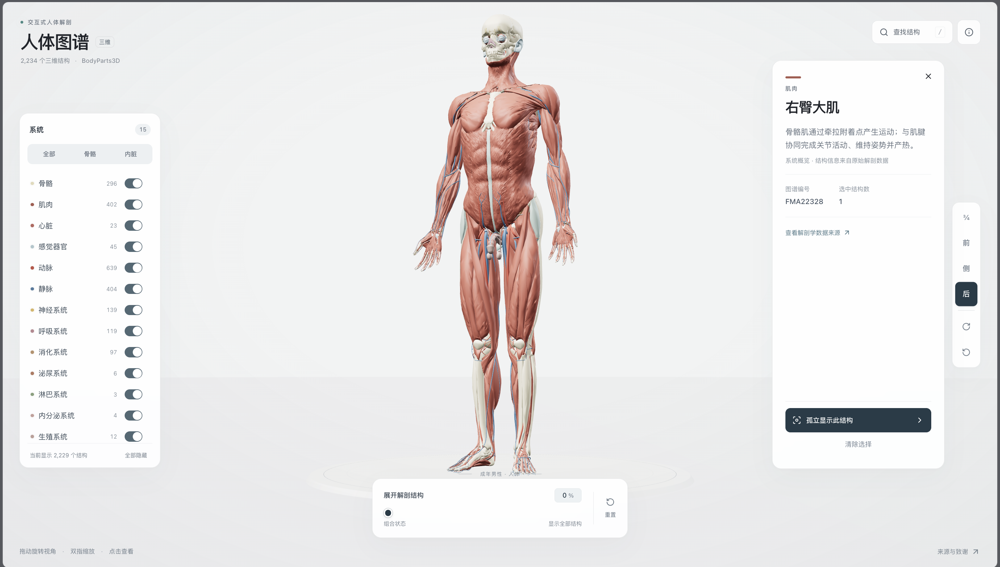

# 人体解剖图谱

一个使用 React、Three.js 和 shadcn/ui 构建的交互式三维解剖探索器。基于 BodyParts3D 成年男性参考解剖模型并补充 Z-Anatomy 肌肉与关节结构，提供 **2,360 个可单独选择的网格**、**15 个解剖系统**和 **3,638 个带名称的概念**。

**[打开中文版在线网站](https://lll888666.github.io/human-atlas-chinese/)**

## 原始仓库

本中文版基于原始项目 **[ashemag/human-atlas](https://github.com/ashemag/human-atlas)**（原仓库名：`human-atlas`）制作。感谢原作者提供交互式三维解剖图谱的应用代码与工程基础。

本仓库在保留原始项目结构、模型数据和许可证要求的基础上，完成了中文界面、本地化医学术语、中文解剖结构名称以及 GitHub Pages 部署适配。解剖数据的来源与归属信息请参阅 [ATTRIBUTION.md](public/ATTRIBUTION.md)。

## 探索方式

- 直接在人体模型上旋转视角、缩放并选择结构。
- 切换单个系统，或使用骨骼和器官预设。
- 从组合状态切换为分散展示，查看每个可见部件。
- 搜索解剖名称和源标识符。
- 隔离选中的结构并查看详情。
- 在移动设备上使用紧凑控件和详情面板。

## 本地运行

需要 Node.js 22.13 或更高版本。不需要 API 密钥或账号。

```sh
npm ci
npm run dev
```

打开 http://localhost:3016。要构建静态网站，请运行 `npm run build`；输出位于 `dist/`。

## 验证

```sh
npm run check
npm run validate:atlas
npm run validate:supplemental
npm run validate:interactions
npm run build
```

浏览器回归测试首次运行前安装 Chromium：

```sh
npx playwright install chromium
npm run test:e2e
```

测试会自动启动独立的本地服务器，覆盖桌面与手机尺寸、搜索键盘操作、图层与隔离、模型加载失败重试，以及 WebGL 初始化失败与会话中断。截图和失败时的追踪文件位于 `test-results/`。

验证内容包括网格缓冲区、名称和概念归属、桌面端与移动端宽高比下不重叠的分散布局、搜索与查看契约，以及点击与拖动的区分。浏览器交互检查已覆盖选择、系统控件、搜索、隔离、旋转，以及 390×844、320×568 和 844×390 布局。手机控件不会遮挡分散展示的部件；隔离结构会适配详情面板上方或旁侧的可用空间。尚未测试实体设备性能和真实多点触控硬件。

## 解剖数据

当前查看器使用 **BodyParts3D 4.0** 成年男性参考解剖模型，依据 **CC BY 4.0** 许可发布。它不涵盖所有人体结构或个体差异。独立源网格与带名称的概念并不相同；一个概念可能包含多个网格。结构说明按概念编号（FMA 及补充结构 ID）独立保存在 `app/data/structure-descriptions.json`，覆盖全部 3,638 个概念。`scripts/structure-notes.txt` 保存可维护的解剖知识条目，运行 `python3 scripts/build-structure-descriptions.py` 可重建完整说明表。分支共用相应解剖主干知识并保留具体名称；原目录中名称过于笼统的集合条目按实际成员或所属结构说明，避免把显示系统分组当作解剖定义。文字为教育用途的整理内容，不是来源数据集自带的专业审校说明。

基础几何体经过简化以提升浏览器性能。当前模型包含 2,533,809 个三角形；Z-Anatomy 补充包新增126个独立结构，更新左右腹外斜肌和腹白线，压缩下载量增加约3.66 MB。原始网格身份保留，替换项的旧几何记录保存在清单中。完整致谢、来源链接和适配详情见 [ATTRIBUTION.md](public/ATTRIBUTION.md)。

本项目是用于学习的探索器，不是诊断或外科工具。

## 工作原理

几何体会合并为批次。按结构划分的 GPU 纹理控制平移、可见性和选择状态，同时保留部件几何体以实现准确拾取。分散布局只排列可见部件。场景发生变化时才更新渲染；轨道控制保持响应，无需为数千个部件分别提交绘制调用。

兼容浏览器可使用可选的 WebMCP 工具进行解剖搜索和查看；即使没有这些工具，可见界面仍能正常使用。

## 重建几何数据

仓库已包含可直接用于浏览器的几何数据。重建是可选的：获取官方 BodyParts3D OBJ 存档和英文元数据表，整理合并后的概念及显示系统映射，运行 `scripts/convert-anatomy.py`，然后依次运行 `node scripts/optimize-anatomy.mjs` 和 `node scripts/compress-models.mjs`。每个结构的简化相对误差上限为 0.2%。

## 部署

将此仓库作为 Vite 项目导入 Vercel。随附的 `vercel.json` 会配置 `npm ci`、`npm run build` 和 `dist` 输出目录。也可以使用静态托管服务部署。

## 许可证

原始应用代码依据 [MIT License](LICENSE) 发布。**解剖数据使用独立的 CC BY 4.0 许可证**；再分发时请保留归属信息。第三方依赖继续遵循各自的许可证。

欢迎提交问题和拉取请求。针对交互问题，请附上复现步骤以及浏览器/设备信息。

鼠标左键或中键拖动平移，平移即时响应鼠标移动，无阻尼缓动；右键拖动绕人体竖直中心轴旋转，滚轮以指针位置缩放。右侧撤销、重做用于结构隐藏历史，底部重置恢复默认视角、图层和全部手动隐藏的结构。

## 肌肉与关节补丁

已接入头面部肌肉、腹壁三层、膝韧带与半月板，以及腕、肩、肘、髋、踝、脊柱的多项韧带。系统面板的“腹壁肌层”可分别隐藏腹外斜肌、腹内斜肌和腹横肌；支持搜索“颞肌”“咬肌”“半月板”“TFCC”等。TFCC 分组仅含已收录组成，腹直肌鞘、TFCC 半月板同源体及尺侧腕伸肌腱鞘底尚未独立建模。几何配准及局部分离未经过专业解剖审校。

补充网格按 CC BY-SA 4.0 发布；基础模型与应用代码保留各自许可证。重建步骤、结构清单、配准依据和已知限制见 [补丁说明](docs/supplemental-structures.md)。
